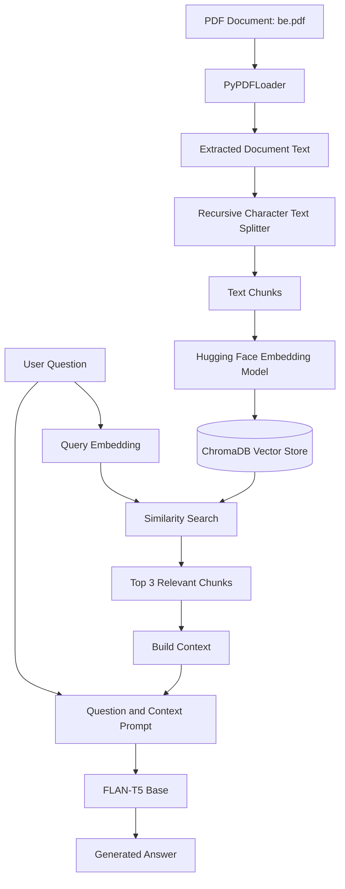

# RAG Basic — PDF Question Answering with Retrieval-Augmented Generation

A minimal, notebook-driven implementation of **Retrieval-Augmented Generation (RAG)**. This project demonstrates how to convert PDF documents into searchable vector representations, retrieve relevant context for user questions, and generate context-aware answers using a language model.

[](https://colab.research.google.com/github/maahii-in/RAG-basic/blob/main/RAG_Basic.ipynb)

> **Project Status:** Educational prototype. This repository demonstrates the core RAG pipeline and is intended for learning and experimentation. It is not a production-ready application.

---

## Table of Contents

- [Overview](#overview)
- [Key Features](#key-features)
- [System Architecture](#system-architecture)
- [How RAG Works](#how-rag-works)
- [Repository Structure](#repository-structure)
- [Technology Stack](#technology-stack)
- [Prerequisites](#prerequisites)
- [Getting Started](#getting-started)
- [Implementation Details](#implementation-details)
- [Configuration](#configuration)
- [Example Interaction](#example-interaction)
- [Limitations](#limitations)
- [Security and Data Handling](#security-and-data-handling)
- [Troubleshooting](#troubleshooting)
- [Future Improvements](#future-improvements)
- [Contributing](#contributing)
- [License](#license)

---

## Overview

Large Language Models (LLMs) can generate fluent responses but may not know the information contained in a specific document. They can also produce answers that are unsupported by the available evidence.

**Retrieval-Augmented Generation (RAG)** addresses this problem by retrieving relevant information from an external knowledge source and providing that information to the language model as context.

This project implements a basic PDF question-answering system using LangChain, Hugging Face Transformers, sentence-transformers, and ChromaDB.

The pipeline follows five main steps:

1. **Document ingestion:** Extract text from a PDF document.
2. **Text chunking:** Split the extracted text into smaller, overlapping chunks.
3. **Embedding and indexing:** Convert chunks into vector representations and store them in ChromaDB.
4. **Context retrieval:** Search for chunks that are semantically similar to the user's question.
5. **Answer generation:** Pass the question and retrieved context to a language model to generate a response.

The notebook uses `be.pdf` as its example document.

## Key Features

- PDF document loading and text extraction.
- Recursive text splitting with configurable chunk size and overlap.
- Semantic embeddings using a pretrained sentence-transformer model.
- Vector storage and similarity search using ChromaDB.
- Context-based answer generation using FLAN-T5.
- GPU acceleration when CUDA is available, with CPU fallback.
- Interactive question-and-answer workflow.
- Google Colab and local Jupyter Notebook support.

## System Architecture

The following diagram illustrates the major components and data flow of the application.



### Architecture Components

| Component | Responsibility |
|---|---|
| PDF Loader | Extracts text from the input PDF |
| Text Splitter | Divides documents into manageable, overlapping chunks |
| Embedding Model | Converts text into numerical vector representations |
| ChromaDB | Stores vectors and supports similarity-based retrieval |
| Retriever | Selects relevant document chunks for a question |
| Prompt Template | Combines the retrieved context and user's question |
| Language Model | Generates an answer using the supplied context |
| Notebook Runtime | Orchestrates ingestion, retrieval, and generation |

## How RAG Works

### 1. Document Ingestion

The system loads the input PDF using LangChain's `PyPDFLoader`.

The extracted document text is prepared for downstream processing.

```python
from langchain_community.document_loaders import PyPDFLoader

loader = PyPDFLoader("/content/be.pdf")
documents = loader.load()
```

### 2. Text Chunking

Long documents are divided into smaller text segments using `RecursiveCharacterTextSplitter`.

Chunking helps the retrieval system identify relevant sections without processing the entire document as one large text block.

The notebook uses the following settings:

| Parameter | Value | Description |
|---|---:|---|
| Chunk size | 800 characters | Maximum target size for each text chunk |
| Chunk overlap | 100 characters | Shared content between consecutive chunks |

```python
from langchain_text_splitters import RecursiveCharacterTextSplitter

text_splitter = RecursiveCharacterTextSplitter(
    chunk_size=800,
    chunk_overlap=100,
)

chunks = text_splitter.split_documents(documents)
```

### 3. Embedding Generation

Each text chunk is converted into a numerical vector using the pretrained model:

`sentence-transformers/all-MiniLM-L6-v2`

These embeddings represent aspects of the semantic meaning of the text and enable similarity-based retrieval.

```python
from langchain_community.embeddings import HuggingFaceEmbeddings

embeddings = HuggingFaceEmbeddings(
    model_name="sentence-transformers/all-MiniLM-L6-v2"
)
```

### 4. Vector Storage

The generated embeddings and associated document content are stored in ChromaDB.

ChromaDB provides a vector-search interface for finding document chunks that are semantically related to a question.

The notebook uses `/content/chroma_db` as its configured storage directory.

```python
from langchain_community.vectorstores import Chroma

vectorstore = Chroma.from_documents(
    documents=chunks,
    embedding=embeddings,
    persist_directory="/content/chroma_db",
)
```

### 5. Context Retrieval

When a user asks a question, the system searches the vector store and retrieves the three most similar chunks.

```python
query = "What information does the document contain?"

relevant_documents = vectorstore.similarity_search(
    query,
    k=3,
)
```

The actual notebook also limits each retrieved chunk to its first 500 characters when building the generation context.

### 6. Answer Generation

The retrieved text is combined with the user's question and passed to the language model.

This project uses the pretrained model:

`google/flan-t5-base`

The generation prompt instructs the model to answer using the supplied context and acknowledge when the answer cannot be found in that context.

This instruction helps encourage grounded responses, but it does not guarantee factual accuracy.

The notebook uses Hugging Face Transformers for tokenization and text generation.

---

## Repository Structure

```text
RAG-basic/
│
├── RAG_Basic.ipynb
│   └── Complete notebook for document ingestion,
│       embedding generation, retrieval, and answer generation
│
├── be.pdf
│   └── Example source document
│
└── README.md
    └── Project documentation
```

## Technology Stack

| Technology | Purpose |
|---|---|
| Python | Primary programming language |
| Jupyter Notebook | Interactive development environment |
| Google Colab | Optional cloud notebook runtime |
| LangChain | Document processing and retrieval components |
| PyPDF | PDF text extraction backend |
| Hugging Face Transformers | Tokenization and language model inference |
| Sentence Transformers | Semantic embedding generation |
| ChromaDB | Vector storage and similarity search |
| PyTorch | Model execution and hardware acceleration |

### Models Used

| Model | Role |
|---|---|
| `sentence-transformers/all-MiniLM-L6-v2` | Converts text into embeddings |
| `google/flan-t5-base` | Generates answers from retrieved context |

## Prerequisites

Before running the project, ensure that you have:

- Python 3.9 or a compatible Python version for the selected dependencies.
- Google Colab or a local Jupyter Notebook environment.
- Access to the source PDF document.
- Internet connectivity for downloading model weights and dependencies during initial setup.
- Sufficient RAM and disk space to load the embedding and generation models.

A compatible GPU can improve inference speed, but a GPU is not mandatory.

## Getting Started

### Option 1: Run Using Google Colab

**Step 1: Open the notebook**

Click the badge at the beginning of this README to open `RAG_Basic.ipynb` in Google Colab.

**Step 2: Clone the repository**

Run the following cell in Colab:

```python
!git clone https://github.com/maahii-in/RAG-basic.git
```

**Step 3: Make the PDF available**

The notebook expects the source document at `/content/be.pdf`.

Copy the repository's example PDF into the expected location:

```python
!cp RAG-basic/be.pdf /content/be.pdf
```

If you have already cloned the repository in the runtime, do not clone it again.

**Step 4: Install dependencies**

Install the notebook's required libraries. The following is a starting point consistent with the notebook's main dependencies:

```python
%pip install \
    "sentence-transformers==2.7.0" \
    langchain \
    langchain-community \
    langchain-text-splitters \
    chromadb \
    pypdf \
    "transformers==4.41.2" \
    torch \
    sentencepiece
```

The notebook's remaining dependencies may need to be installed depending on the environment. For reproducible execution, pin and test the complete dependency set.

**Step 5: Run the notebook**

Execute the cells in order:

1. Install dependencies.
2. Load and process the PDF.
3. Split the document into chunks.
4. Generate embeddings and create the Chroma vector store.
5. Load the language model and tokenizer.
6. Run the question-answering loop.

**Step 6: Ask questions**

Enter a question about the loaded document when prompted.

Enter `exit` to quit the interactive question-answering loop.

### Option 2: Run Locally

**Step 1: Clone the repository**

```bash
git clone https://github.com/maahii-in/RAG-basic.git
cd RAG-basic
```

**Step 2: Create a virtual environment**

Linux or macOS:

```bash
python3 -m venv .venv
source .venv/bin/activate
```

Windows PowerShell:

```powershell
python -m venv .venv
.venv\Scripts\Activate.ps1
```

**Step 3: Upgrade pip**

```bash
python -m pip install --upgrade pip
```

**Step 4: Install dependencies**

```bash
python -m pip install \
    "sentence-transformers==2.7.0" \
    langchain \
    langchain-community \
    langchain-text-splitters \
    chromadb \
    pypdf \
    "transformers==4.41.2" \
    torch \
    sentencepiece \
    jupyter
```

These commands are a starting point, not a verified lockfile. Transitive dependencies and library APIs can change over time. Resolve and test a compatible set of versions before relying on a particular environment.

**Step 5: Configure the PDF path**

The notebook was written for a Colab-style environment and currently references `/content/be.pdf`.

When running locally, change the input path in the relevant notebook cell to:

```python
from pathlib import Path

folder_path = str(Path("be.pdf").resolve())
```

Ensure the notebook uses `folder_path` as the loader input, or update the original loader path directly.

**Step 6: Start Jupyter Notebook**

```bash
jupyter notebook RAG_Basic.ipynb
```

Run the notebook cells in order.

---

## Implementation Details

### Current Pipeline Settings

The following values reflect the notebook implementation.

| Setting | Value |
|---|---|
| Input document | `/content/be.pdf` |
| Chunk size | 800 characters |
| Chunk overlap | 100 characters |
| Embedding model | `sentence-transformers/all-MiniLM-L6-v2` |
| Vector store | ChromaDB |
| Configured persistence directory | `/content/chroma_db` |
| Number of retrieved chunks | 3 |
| Context length per retrieved chunk | First 500 characters |
| Generation model | `google/flan-t5-base` |
| Tokenizer input limit | 1,024 tokens |
| Maximum new tokens | 300 |
| Inference device | CUDA when available; otherwise CPU |

These are prototype defaults, not universally optimal settings. Their suitability should be evaluated against document content, retrieval quality, generation latency, and hardware constraints.

### Why Use Embeddings?

A conventional keyword search looks for matching words. Vector search represents the semantic content of text and can retrieve related passages even when the wording differs.

For example, a question about account security may retrieve a passage discussing access controls, even if the exact words in the question do not appear in that passage.

Semantic retrieval is not perfect. Its quality depends on the embedding model, document preparation, chunking strategy, and retrieval configuration.

### Why Use a Vector Database?

A vector database stores embeddings alongside associated content and allows the application to search for similar vectors.

In this project, ChromaDB provides the vector storage and similarity-search functionality.

For larger deployments, the persistence strategy, index lifecycle, storage capacity, concurrent access, and backup requirements must be designed explicitly.

### Why Combine Retrieval With Generation?

Retrieval identifies potentially useful evidence from the source document. The language model uses that evidence to formulate a response in natural language.

This separates two important responsibilities:

- **Retrieval:** Find relevant information in the document.
- **Generation:** Construct a readable answer using the retrieved information.

The result can be more useful than asking the language model a question without providing the source document. However, incorrect retrieval or poor generation can still result in an unsupported answer.

## Configuration

The current notebook stores its main settings directly in notebook cells. There is no dedicated configuration module in the repository.

The most useful parameters to make configurable in a future version are:

| Parameter | Purpose |
|---|---|
| `PDF_PATH` | Location of the input document |
| `CHUNK_SIZE` | Maximum text chunk size |
| `CHUNK_OVERLAP` | Overlap between consecutive chunks |
| `EMBEDDING_MODEL` | Model used for document and query embeddings |
| `VECTORSTORE_PATH` | Location of the persisted vector store |
| `TOP_K` | Number of documents retrieved for a question |
| `CONTEXT_CHAR_LIMIT` | Maximum characters included from each retrieved chunk |
| `GENERATION_MODEL` | Language model used to generate answers |
| `MAX_NEW_TOKENS` | Maximum number of generated tokens |

These names are suggested configuration conventions. They are not existing environment variables exposed by the current notebook.

## Example Interaction

The notebook provides an interactive question-and-answer loop.

```text
Ask question: What does the document say about access controls?

Answer:
[Generated response based on the retrieved document context]

------------------------------------------------------------

Ask question: exit

Goodbye!
```

The output above is illustrative. Actual answers depend on the source document, retrieved passages, model behavior, and runtime environment.

## Limitations

This project demonstrates the fundamentals of RAG, but several areas should be improved before it is used as a reliable application.

### 1. Source Attribution

The current answer-generation flow does not provide an established source-citation interface showing the PDF page and supporting passage for each answer.

**Improvement:** Preserve source metadata during ingestion and return relevant excerpts and page references alongside generated answers.

### 2. Retrieval Quality

The notebook retrieves three similar chunks without a configured relevance threshold.

A similarity search may return weakly relevant passages even when the question cannot be answered from the document.

**Improvement:** Evaluate retrieval quality, tune the number of results, and implement an appropriate relevance threshold.

### 3. Context Truncation

Each retrieved passage is limited to its first 500 characters during context construction.

Important details appearing later in a chunk may be omitted.

**Improvement:** Use a configurable context budget and evaluate truncation strategies against real questions.

### 4. Document Metadata

Combining page text before splitting can lose the page-level relationship between chunks and their original PDF locations.

**Improvement:** Preserve page metadata through chunking and retrieval so source references can be displayed accurately.

### 5. Model Hallucination

A prompt instruction to answer only from the provided context does not guarantee that the model will always follow that instruction.

**Improvement:** Add groundedness evaluation, answer-abstention handling, source verification, and tests for questions whose answers are absent from the document.

### 6. Dependency Management

Not every direct dependency is version-pinned.

This may result in different dependency resolutions or incompatible library APIs across installations.

**Improvement:** Maintain a tested dependency file or lockfile and validate the environment in automated tests.

### 7. Persistence

The configured `/content/chroma_db` directory is located in the notebook runtime's filesystem.

In Colab, the runtime filesystem should not be treated as durable storage across runtime resets.

**Improvement:** Define an explicit persistence and backup strategy appropriate to the deployment environment.

### 8. Application Interface

The project is notebook-oriented and does not currently provide a dedicated API or web interface.

**Improvement:** Extract reusable application logic and add a CLI or API with clear input validation and error handling.

### 9. Production Readiness

The current repository does not establish production-grade authentication, authorization, observability, load handling, resource controls, or operational recovery.

**Improvement:** Design these controls before exposing the system to multiple users or sensitive workloads.

---

## Security and Data Handling

Documents may contain confidential, personal, or organization-specific information. Handle source files and generated responses carefully.

- **Review `be.pdf` before distributing the public repository.** The example document appears to contain organization-specific IT policy information and a confidentiality notice. Confirm that you have permission to publish it. Replace it with a sanitized or synthetic document if required.
- Only process documents you are authorized to access and use.
- Do not commit passwords, API keys, access tokens, or other secrets to the repository.
- Treat retrieved document content as untrusted input. Retrieved text must not be allowed to override application instructions or security policies.
- Do not use model responses as the sole authority for security, legal, compliance, or other high-impact decisions.
- For sensitive deployments, define data-retention, access-control, logging, and deletion policies.
- Verify answers against the original document when accuracy matters.

## Troubleshooting

### PDF file not found

**Possible cause:** The notebook expects the PDF at `/content/be.pdf`, but the file is elsewhere.

**Solution:** Upload the PDF to Colab or update the loader path to the correct local file.

### Model downloads are slow

**Possible cause:** Hugging Face models and their dependencies may need to be downloaded the first time they are loaded.

**Solution:** Ensure internet access is available during initial setup and allow sufficient disk space for model weights and caches.

### Out-of-memory errors

**Possible cause:** The generation model, embedding model, or vector-store operations exceed available memory.

**Solution:** Close unnecessary applications, use an appropriate runtime, process documents in manageable batches, or select smaller models.

### CUDA is unavailable

**Possible cause:** PyTorch may be installed without compatible GPU support, or the runtime may not expose a supported GPU.

**Solution:** Verify the PyTorch installation and available hardware. The application can run on CPU, although inference may be slower.

### Dependency or import errors

**Possible cause:** Installed library versions may not match the API used by the notebook.

**Solution:** Use a clean virtual environment, install a tested dependency set, and record compatible versions in the project's dependency file.

### Answers do not match the document

**Possible cause:** Retrieval may select irrelevant chunks, important content may be truncated, or the language model may misinterpret its context.

**Solution:** Inspect retrieved passages, evaluate chunking settings, adjust the retrieval configuration, and compare generated answers with the original PDF.

---

## Future Improvements

The following roadmap outlines a practical way to evolve this educational notebook into a more maintainable application.

### Phase 1: Reproducibility

- Pin and test all direct dependencies.
- Add a `requirements.txt` or lockfile.
- Document the supported Python versions.
- Add sample configuration and clear setup instructions.
- Separate environment setup from application execution.

### Phase 2: Retrieval Quality

- Preserve page numbers and source metadata.
- Return citations and supporting passages.
- Evaluate chunk size, overlap, and retrieval depth.
- Implement configurable relevance thresholds.
- Test questions with both available and unavailable answers.

### Phase 3: Application Engineering

- Separate document ingestion from query-time execution.
- Extract reusable code into modules.
- Add configuration management and structured error handling.
- Introduce automated tests.
- Add a command-line or API interface.

### Phase 4: Evaluation and Observability

- Build a representative question-and-answer evaluation dataset.
- Measure retrieval relevance and answer correctness.
- Track latency and resource consumption.
- Evaluate groundedness and refusal behavior.
- Log operational metadata without unnecessarily exposing sensitive document content.

### Phase 5: Production Preparation

- Define authentication and authorization requirements.
- Establish a secure document ingestion process.
- Add storage lifecycle management and backups.
- Apply resource limits and request validation.
- Introduce monitoring, deployment procedures, and recovery plans.
- Complete security and performance testing before production use.

These steps are recommendations for future development. They are not claims that the current notebook already implements these capabilities.

## Contributing

Contributions that improve correctness, reproducibility, documentation, and maintainability are welcome.

A suggested workflow:

1. Fork the repository.
2. Create a feature branch.
3. Make a focused change.
4. Test the relevant notebook workflow.
5. Update documentation when behavior changes.
6. Submit a pull request describing the changes and validation performed.

Example:

```bash
git checkout -b feature/improve-retrieval
git add .
git commit -m "Improve document retrieval workflow"
git push origin feature/improve-retrieval
```

Before contributing, check that no confidential documents, credentials, generated model files, or local environment artifacts are accidentally included in a commit.

## License

No license file is currently included in the repository.

Until a license is added, do not assume that others have permission to reuse or redistribute the code or document assets. Confirm the relevant rights before publishing or reusing these materials.

---

**Project Summary:** RAG Basic demonstrates how PDF text extraction, chunking, semantic embeddings, vector similarity search, and language-model generation can work together to build a document question-answering pipeline.

The project provides a foundation for exploring retrieval-augmented generation and identifying the engineering improvements required for a more reliable, maintainable, and production-oriented implementation.
